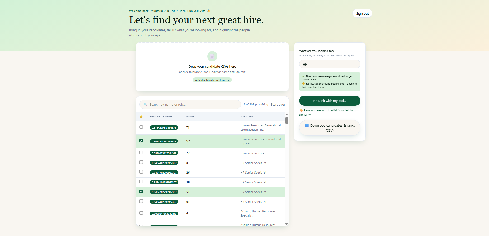

# HR Semantic Keyword Match & Candidate Ranker

A serverless, privacy-focused HR intelligence tool that ranks and refines candidate pools using semantic AI. Instead of relying on rigid, literal keyword matches, this system evaluates the conceptual intent of job titles and matching criteria using a fine-tuned BERT transformer model.

🚀 **[Checkout the Live Website!](https://main.dsrisyuuzm8cs.amplifyapp.com/)**



## ✨ Core Features

* **Secure Data Isolation:** Built-in user authentication ensures your sensitive candidate data remains completely private and discrete.
* **Semantic Title Matching:** Evaluates true professional context rather than basic keyword counts by mapping embeddings via a specialized job-market transformer model.
* **Dynamic Feedback Loop (Reranking):** Select standout or "promising" candidates on the fly to instantly dynamically recalculate scores and elevate similar profiles.
* **Seamless CSV Workflows:** Upload raw data containing job titles and identifiers, then download the structured results enriched with a calculated `similarity_score` column.

## 🛠️ Architecture & Technical Deep Dive

This application runs entirely on an **ultra-low-cost, zero-idle serverless infrastructure** that automatically scales down to **$0/hr** when not in use.

### Architecture Breakdown
* **Frontend:** Built with **React (Vite)**, strictly typed with **TypeScript**, and styled using **Tailwind CSS**.
* **Cloud Orchestration:** Fully managed and deployed via **AWS Amplify Gen 2**, handling frontend hosting, authentication infrastructure, and serverless compute mapping.
* **Authentication:** Fully secured using native **Amazon Cognito** user pools.
* **AI Backend:** A containerized **Python AWS Lambda function** deployed as a 10GB Docker image to natively support heavy machine learning footprints.
* **ML Inference Pipeline:** Powered by **PyTorch** and **Sentence-Transformers** utilizing the specialized `TechWolf/JobBERT-v2` transformer model.

> 💡 **Design Trade-off Note:** To keep the system completely cost-free at rest, the Lambda function handles model loading dynamically. This introduces a cold-start duration during initial invocations while the container initializes and spins up the BERT layers. Warm invocations leverage execution context caching in the container's temporary storage `/tmp` for near-instantaneous inference.

## 📂 Project Structure

```text
my-hr-ranking-app/
├── amplify/                  # Backend infrastructure definitions
│   ├── auth/                 # Cognito resource configuration
│   ├── functions/            
│   │   └── ranker/           
│   │       ├── handler.py    # Core ML logic (PyTorch/BERT similarity & embedding blend)
│   │       └── Dockerfile    # 10GB container definition containing ML weights & layers
│   └── backend.ts            # Glues Auth, Storage, and Python execution together
└── src/                      # Single-Page Application Frontend
    ├── components/           # UI elements & layout structures
    ├── App.jsx               # React core state engine and direct AWS SDK execution pipelines
    └── main.jsx
```

## 🚀 Getting Started

### Prerequisites
* **Node.js** (v18 or higher recommended)
* **AWS CLI** configured with appropriate developer credentials
* **Docker Desktop** (required for compiling and local testing of the Lambda image container)

### Local Development Setup

1. **Clone the repository:**
   ```bash
   git clone https://github.com
   cd HR-Semantic-Keyword-Match
   ```

2. **Install frontend and platform dependencies:**
   ```bash
   npm install
   ```

3. **Launch the local AWS Amplify cloud sandbox:**
   ```bash
   npx ampx sandbox
   ```
   *This environment instantly provisions isolated cloud resources directly inside your AWS developer profile for real-time live debugging.*

4. **Run the local Vite web preview container:**
   ```bash
   npm run dev
   ```

## 📊 Core Vector Logic (How Reranking Works)

When you choose a standout candidate, the backend shifts your initial keyword objective vector using a linear blend controlled by an adjustment factor ($\alpha = 0.4$):

$$\vec{V}_{\text{new}} = (1 - \alpha) \cdot \vec{V}_{\text{initial\\_keywords}} + \alpha \cdot \vec{V}_{\text{promising\\_candidate}}$$

This updates your search target relative to real candidate behaviors, optimizing downstream semantic cosine similarities immediately.
